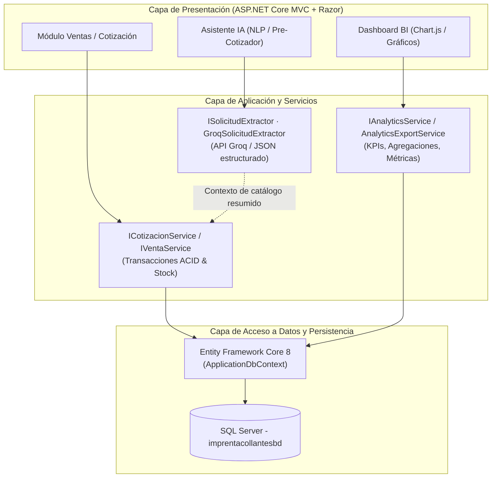

# Especificación de Requerimientos del Sistema (SRS)
## Sistema de Gestión Comercial, Cotizaciones y Producción — Imprenta Collantes

* **Curso:** Diseño y Arquitectura de Software  
* **Nivel:** Ciclo VII — Universidad Privada del Norte (UPN)  
* **Tecnología Base:** ASP.NET Core (.NET 8), Entity Framework Core 8, SQL Server, Bootstrap 5  
* **Pilares de Arquitectura:** Transaccional (OLTP / ACID), Business Intelligence (BI) e Inteligencia Artificial (IA)

**Estado de cierre (2026-11-09): concluido según la evidencia registrada en [CIERRE_REQUERIMIENTOS.md](CIERRE_REQUERIMIENTOS.md).** La medición de rendimiento usa una carga sintética representativa en una base SQL temporal; los tramos de descuento comerciales siguen pendientes de configuración por Admin.

---

## 1. Introducción y Alcance

El presente documento formaliza los **Requerimientos Funcionales (RF)** y **Requerimientos No Funcionales (RNF)** para la evolución y completitud del sistema de información comercial y productivo para imprenta. El sistema cubre desde la captación y cotización con asistencia de Inteligencia Artificial, pasando por la conversión transaccional en pedidos de producción con descuento atómico de inventario, hasta la explotación analítica para toma de decisiones gerenciales mediante Business Intelligence.

---

## 2. Diagrama Arquitectónico de los Pilares del Sistema

---

## 3. Requerimientos Funcionales (RF)

### Módulo 1: Seguridad, Autenticación y Auditoría (RBAC)
* **RF-01: Autenticación y Gestión de Sesiones**
  * **Descripción:** El sistema debe permitir el inicio de sesión seguro mediante correo y contraseña cifrada, cierre de sesión y recuperación de contraseña por correo electrónico.
  * **Criterio de Aceptación:** Bloquear accesos tras intentos fallidos y mantener la sesión cifrada mediante cookies provistas por ASP.NET Core Identity.
  * **Estado actual:** Identity bloquea tras cinco intentos fallidos durante 15 minutos; las cookies son `HttpOnly`, duran ocho horas y exigen `Secure` en producción. Los tokens de recuperación válidos, vencidos y reutilizados se probaron. El envío usa `SmtpEmailSender` configurado por Admin en Parámetros. Tras restaurar la base en `MSSQLSERVER01`, la contraseña SMTP cifrada referencia una clave ausente del keyring actual; Admin debe volver a guardarla antes de validar la entrega real. Consulta la [guía de Gmail](CONFIGURAR_CORREO_GMAIL.md).
* **RF-02: Control de Acceso Basado en Roles (RBAC)**
  * **Descripción:** Restricción estricta de controladores y vistas según el rol del usuario autenticado: `Admin` (gestión total y asignación de roles/permisos), `Vendedor` (clientes, cotizaciones y ventas) y `Operador de Taller` (seguimiento de producción). La matriz de acceso relaciona roles con menús y operaciones (`ver`, `crear`, `editar`, `eliminar`, `procesar`).
  * **Criterio de Aceptación:** Los endpoints sensibles deben requerir autenticación y validar en el servidor el permiso por rol y operación; ocultar el menú no constituye autorización. `Admin` tiene acceso total y puede administrar los permisos de los demás roles.
* **RF-03: Auditoría y Trazabilidad Automática**
  * **Descripción:** Las creaciones y cambios de estado de cotizaciones, ventas y pedidos registran identificador del usuario en sesión (`ClaimsPrincipal`), fecha/hora UTC y transición; los vencimientos automáticos quedan identificados como acciones del sistema. El historial solo es visible para `Admin`.
  * **Estado actual:** las emisiones, ediciones, conversiones, confirmaciones, cancelaciones, creación/avance/cancelación de pedidos y vencimientos automáticos registran acción, entidad, usuario cuando aplica, UTC y estado anterior/nuevo. Los vencimientos usan transición condicional para evitar auditorías duplicadas entre instancias; los registros de auditoría se guardan en la misma transacción que la operación y la consulta está restringida a `Admin`.

---

### Módulo 2: Clientes, Proveedores y Catálogo
* **RF-04: Gestión Integral de Clientes**
  * **Descripción:** Registro, edición, búsqueda y consulta de clientes con validación estricta de documentos de identidad peruanos (DNI de 8 dígitos o RUC de 11 dígitos), correo electrónico válido y teléfono.
  * **Estado actual:** selector de tipo de documento importado de `facturuna`, número de documento y nombre/razón social; dirección y ubigeo de distrito obligatorios con RUC y opcionales con DNI. Los DNI antiguos se conservan y son buscables junto al número de documento nuevo. Correo y teléfono son opcionales, pero se valida su formato si se ingresan. El listado permite filtrar por nombre, documento, correo y teléfono, con paginación. Se valida el formato y unicidad documental en clientes, no la situación tributaria ante SUNAT.
* **RF-05: Historial y Ficha Comercial del Cliente**
  * **Descripción:** En la vista de detalle del cliente se debe desplegar el histórico completo de sus cotizaciones emitidas, pedidos formalizados y volumen total facturado.
  * **Estado actual:** la ficha muestra cotizaciones y pedidos completos con paginación, números, fechas, estados, importes y enlaces a sus detalles. El resumen suma ventas confirmadas con IGV y excluye las canceladas. Como el sistema no emite comprobantes tributarios, se presenta como volumen de ventas confirmadas y no como facturación.
* **RF-06: Gestión de Proveedores e Insumos**
  * **Descripción:** Registro y mantenimiento de proveedores asociados a los insumos y productos de imprenta.
  * **Criterio de Aceptación:** En cualquier desplegable o formulario del sistema se debe mostrar el Nombre/Razón Social del proveedor y no códigos numéricos internos.
  * **Estado actual:** la ficha muestra identificación compartida, contacto, dirección, ubigeo y productos asociados al proveedor; el directorio permite buscar por nombre, documento y contacto. Los registros anteriores mantienen vacíos los datos desconocidos. No se presenta historial de compras porque ese flujo aún no se registra. El catálogo `ubigeo` proviene de MySQL y se consulta localmente en SQL Server.
* **RF-07: Catálogo de Productos y Servicios de Imprenta**
  * **Descripción:** Mantenimiento de artículos y servicios de imprenta, con precios base; solo los artículos participan en el control de stock. Los registros anteriores a la clasificación deben revisarse manualmente para marcar los servicios reales. La unidad de medida continúa como capacidad objetivo.
  * **Estado actual:** se importaron 64 unidades de medida y existe administración de unidad base y presentaciones con factor por artículo. Los dos artículos anteriores fueron verificados con unidad base `UNIDAD (BIENES)` y presentación `Unidad` factor 1. El almacén principal está activo y conserva los conteos físicos `INV1-00000001` y `INV1-00000002`; los saldos por almacén son la fuente operativa y `Producto.Stock` se mantiene como dato heredado, sin copiarlo ni sumarlo. Las aperturas de almacenes nuevos exigen contar todos los artículos, incluidos los ceros. La presentación ya está integrada al flujo comercial: la cotización guarda factor y nombres como snapshot, el precio se escala por presentación y la confirmación/cancelación convierte a unidades base para stock y Kárdex.

---

### Módulo 3: Flujo Comercial y Transaccional (OLTP - ACID)
* **RF-08: Registro Maestro-Detalle de Cotizaciones**
  * **Descripción:** Registro dinámico de cotizaciones permitiendo asociar un cliente y agregar múltiples líneas de ítems (`DetalleCotizacion`) con producto, tiraje/cantidad y precio unitario pactado.
  * **Estado actual:** cada línea permite seleccionar artículo/servicio, presentación, cantidad y precio por presentación. El factor y los nombres usados quedan guardados como snapshot; cambios posteriores al catálogo no alteran documentos emitidos.
* **RF-09: Cálculo Automatizado de Importes e Impuestos**
  * **Descripción:** El sistema debe calcular en tiempo real el subtotal por ítem, subtotal general, IGV (18%) y total neto. Queda bloqueada la edición manual del importe total.
  * **Estado actual:** el navegador recalcula el importe de cada línea al cambiar cantidad, producto, presentación o precio; el servidor vuelve a calcular y validar subtotal, IGV y total al guardar y al confirmar. El precio por presentación se deriva del precio de unidad base multiplicado por el factor.
* **RF-10: Transacción Atómica de Conversión de Cotización a Venta y Pedido de Taller**
  * **Descripción:** Al pulsar «Confirmar venta» en una cotización `Emitida` y vigente, el sistema ejecuta en una **única transacción atómica (ACID)**:
    1. Reserva la conversión única de la cotización y valida el stock de artículos; se permite cotizar sin existencias, pero no confirmar una venta sin ellas.
    2. Crea la `Venta` comercial y sus líneas (`DetalleVenta`) con los importes pactados, y descuenta stock de artículos (no de servicios).
    3. Crea un `Pedido` de taller asociado a la venta, copia sus líneas (`DetallePedido`) y lo deja `En cola`.
    4. Marca la cotización `Convertida` y bloquea su edición.
  * **Criterio de Aceptación:** Una cotización genera como máximo una venta y un trabajo asociado. Si algún artículo no tiene stock suficiente, no se crea ninguno de ellos ni se descuenta inventario (**Rollback**).
  * **Estado actual:** al confirmar, las cantidades de presentación se convierten a unidades base para validar y descontar el almacén seleccionado. Venta y pedido conservan el snapshot de presentación; el Kárdex registra unidades base.
* **RF-11: Anulación Transaccional de Ventas**
  * **Descripción:** Solo se puede cancelar la venta y su pedido asociado mientras el trabajo siga `En cola`. La operación restituye stock de artículos (no servicios) de forma transaccional; una vez iniciado el trabajo no se puede cancelar por este flujo.
  * **Estado actual:** la restitución aplica el mismo factor a las unidades base y solo puede ganar la transición condicional desde `En cola`. En instalaciones sin inventario por almacén, se rechazan presentaciones cuya cantidad base sea fraccionaria o no quepa en el stock legado entero.
* **RF-12: Emisión de Comprobante / Proforma en PDF y Envío por Correo**
  * **Descripción:** Generación de la cotización formal con diseño membretado en formato PDF descargable y opción de envío automático por correo al cliente vía `IEmailSender`.
  * **Estado verificado:** `Descargar PDF` genera A4 en el servidor con snapshot de presentación, cantidades, importes e IGV; `Enviar al cliente` adjunta ese PDF por `SmtpEmailSender` y registra auditoría del envío exitoso. El destinatario confirmó recepción y apertura del PDF enviado desde el botón; la auditoría de la cotización 4 se verificó en SQL Server 2025. Consulta la [guía de Gmail](CONFIGURAR_CORREO_GMAIL.md). La venta sigue siendo documento interno, no comprobante tributario.
* **RF-13: Seguimiento del Estado del Pedido (Taller)**
  * **Descripción:** El taller puede avanzar el pedido solo al siguiente estado: `En cola` → `En impresión / acabado` → `Listo para recojo` → `Entregado`. `Cancelado` solo es posible al cancelar la venta antes de iniciar el trabajo.
  * **Estado actual:** se permite avanzar solo al siguiente estado; pruebas verifican que no se puede saltar ni retroceder. La carrera SQL entre cancelar una venta y comenzar el trabajo fue probada: solo una transición puede triunfar.

---

### Módulo 4: Business Intelligence (BI) y Analítica Gerencial
  * **Estado verificado:** `Analytics/Index` está restringido a `Admin`; usa datos confirmados, excluye cancelaciones, separa IGV y etiqueta la utilidad parcial si faltan costos. Pruebas de aceptación verifican funnel, tendencia, Pareto, ticket, ABC, alertas y factores; pruebas SQL verifican traducciones. Diez solicitudes HTTP autenticadas de 366 días con 10 000 ventas y 30 000 líneas sintéticas quedaron bajo 1,5 s en SQL Server 2025 local. RF-19 ofrece exportación Excel/PDF con los mismos filtros.
* **RF-14: Dashboard Ejecutivo Interactivo**
  * **Descripción:** Panel de indicadores clave (KPIs) basados en datos reales:
    - Ventas confirmadas agrupadas por fecha de confirmación en hora peruana, con IGV mostrado y desglosado; no se llaman «facturadas» mientras no exista facturación real.
    - Cotizaciones emitidas en el periodo, convertidas, vigentes y vencidas según fecha de emisión.
    - Pedidos en proceso en taller.
    - Alertas de artículos con stock menor o igual al umbral seleccionado.
     - Utilidad estimada sin IGV de líneas con costo registrado; indicar explícitamente cuando la cobertura es parcial.
  * **Estado actual:** los indicadores y filtros están implementados; los estados actuales de taller/stock se muestran aparte de los importes del periodo. La prueba SQL valida las consultas con el proveedor real.
* **RF-15: Análisis del Embudo de Conversión Comercial (Funnel)**
  * **Descripción:** Tasa de conversión comercial: cotizaciones convertidas / cotizaciones emitidas en el periodo, presentada como embudo visual.
  * **Estado actual:** implementado. `Analytics/Index` muestra la tasa porcentual y un embudo accesible (`#embudo-conversion`) con emitidas → vigentes → convertidas → vencidas, con amplitud proporcional y etiquetas numéricas. `NavigationTests.AdminCanOpenPanelAndModules` verifica su renderizado.
* **RF-16: Análisis de Tendencia Temporal de Ventas**
  * **Descripción:** Serie mensual/semanal de ventas confirmadas con IGV y filtros por rango de fechas, renderizada con una librería de gráficos del lado del cliente.
  * **Estado actual:** implementado con **Chart.js 4.4.8** (CDN jsDelivr con `integrity`) y una tabla alternativa accesible. Agrupa semanalmente hasta 90 días y por mes para periodos mayores, en fecha peruana de confirmación.
* **RF-17: Análisis Pareto (80/20) de Productos y Servicios Más Vendidos**
  * **Descripción:** Ranking por ingresos con IGV y porcentaje acumulado; no llamar «rentables» a productos sin un cálculo completo de costos e impuestos.
  * **Estado actual:** Top 10 por ingresos con IGV y porcentaje acumulado respecto del total de todos los productos del periodo; las unidades se muestran en base equivalente.
* **RF-18: Ranking y Segmentación de Clientes (Ticket Promedio y Recurrencia)**
  * **Descripción:** Ranking por ventas confirmadas con IGV en el periodo, cantidad, ticket medio y grupo ABC por proporción acumulada de ingresos. Incluye análisis histórico de recurrencia.
  * **Estado actual:** Top 10 con ventas, total, ticket medio y grupos A/B/C. Se añadieron KPIs de recurrencia (clientes con ≥ 2 compras confirmadas en el periodo, % de recurrentes, ticket medio recurrente vs. nuevo) y, por cliente, última compra, días sin comprar y frecuencia media calculada con todo el historial. `AnalyticsTests.ClientRecurrenceUsesPeriodPurchasesAndFullHistory` lo verifica; las exportaciones Excel/PDF incluyen las nuevas columnas.
* **RF-19: Exportación de Reportes Analíticos**
  * **Descripción:** Los datos del módulo de BI deben ser exportables a formatos Excel (`.xlsx`) y PDF con resúmenes ejecutivos.
  * **Estado actual:** Admin puede descargar Excel con hojas de resumen, tendencia, productos, clientes, taller y stock, o PDF A4 ejecutivo. Ambos reutilizan los filtros y métricas del dashboard y se generan en memoria; las pruebas verifican formatos y endpoints autorizados.

---

### Módulo 5: Asistente Inteligente con IA (NLP & Automatización)
 * **Estado actual:** pre-cotización optativa con Groq; revisión explícita del texto anonimizado antes de la llamada, permisos de creación, validación de respuesta y traspaso al formulario normal sin guardado automático. Un preprocesador local detecta DNI/RUC y nombres etiquetados por separado y nunca los agrega a la petición Groq; el vendedor confirma el candidato y debe elegir un cliente registrado. Los detalles del trabajo provienen de IA. Sin clave o ante fallos se sigue cotizando manualmente. Las referencias de precio se calculan localmente; no hay descuentos automáticos ni optimización predictiva de cierre.
* **RF-20: Asistente Inteligente de Pre-Cotización por Lenguaje Natural**
  * **Descripción:** El vendedor podrá ingresar o pegar un texto no estructurado (proveniente de un correo o mensaje de WhatsApp de un cliente) en una caja de texto del módulo de IA.
  * **Criterio de Aceptación:** El servicio de IA procesará el texto y retornará un objeto estructurado (JSON) extrayendo:
    - Datos del cliente (Nombre/Razón Social, DNI/RUC si estuviera presente).
    - Lista de productos identificados con cantidades y descripciones técnicas (tipo de papel, tamaño, acabado).
    - Observaciones o fecha requerida de entrega.
  * **Estado actual:** la IA devuelve las líneas, especificaciones, observaciones y fecha; DNI/RUC y nombre etiquetados se extraen localmente, se presentan aparte y requieren confirmación humana para sugerir coincidencia exacta. No se envía esa identidad al proveedor externo ni se crea/actualiza un cliente automáticamente. Por privacidad, la extracción de identidad no la realiza el modelo remoto; las personas/direcciones libres requieren revisión explícita.
* **RF-21: Autocompletado del Formulario de Cotización desde IA**
  * **Descripción:** Al presionar "Cargar a Cotización", los datos estructurados por la IA deben prellenar automáticamente la pantalla de registro maestro-detalle, asociando los productos coincidentes del catálogo para su revisión final por el vendedor.
  * **Estado actual:** los nombres exactos y únicos se preseleccionan; coincidencias por términos normalizados en nombre/descripción se muestran como sugerencias y no se eligen si son ambiguas. El vendedor confirma producto y presentación, y el servidor valida la selección antes de cargar la cotización normal. Sin coincidencia no se crea nada.
* **RF-22: Recomendación explicable de precios y descuentos**
  * **Descripción:** Admin define por producto tramos de cantidad mínima y descuento sugerido. El sistema recomienda un precio por presentación usando el tramo aplicable y la última venta comparable del cliente, limitado por el precio mínimo que conserva un margen bruto del 10 %. El vendedor elige el precio final. No se predice la probabilidad de cierre.
  * **Estado verificado con datos de prueba:** los tramos se administran en el detalle de producto; el cálculo se muestra al cargar un borrador asistido o al revisar una cotización manual, sin guardarla. No envía costos ni historial a Groq. Sin costo válido o sin tramo aplicable se muestran referencias sin recomendación. La migración `TramosDescuentoProducto` se aplicó en SQL Server 2025. Una prueba HTTP y SQL con un tramo configurado en una base temporal verificó la recomendación, el margen mínimo y la conservación del precio elegido por el vendedor. Admin aún debe introducir los tramos comerciales reales.

---

## 4. Requerimientos No Funcionales (RNF)

| Código | Categoría (ISO 25010) | Requisito y Criterio de Aceptación |
| :--- | :--- | :--- |
| **RNF-01** | **Seguridad** | **Protección contra vulnerabilidades Web:** Toda petición HTTP POST de mutación debe validar tokens anti-falsificación (`[ValidateAntiForgeryToken]`). No deben existir credenciales hardcodeadas en código fuente; las cadenas de conexión y claves de API (Groq) deben gestionarse mediante variables de entorno o `UserSecrets`. |
| **RNF-02** | **Confiabilidad (ACID)** | **Integridad Transaccional:** Las operaciones compuestas (Cotización + Detalles; confirmación de Venta + Pedido + stock; cancelación + restitución de stock) se ejecutan en una transacción (`BeginTransactionAsync`) con aislamiento `ReadCommitted`. Ante un fallo se revierte la transacción completa. |
| **RNF-03** | **Concurrencia** | **Manejo de Concurrencia:** `Producto.RowVersion` impide sobrescribir ediciones de stock desactualizadas. La confirmación usa actualización condicional de inventario y reserva exclusiva de cotización; la cancelación y el inicio del taller usan transiciones condicionales dentro de transacciones para que no puedan ganar ambos a la vez. |
| **RNF-04** | **Arquitectura de Software** | **Cumplido:** el sistema se organiza en capas (Presentación MVC/Razor, Aplicación/Servicios, Persistencia con EF Core). Los controladores MVC delegan consultas y mutaciones a servicios con interfaces; `ProductoesController` usa `IProductosCatalogoService`. No se usan repositorios genéricos: `ApplicationDbContext` cumple el rol de unidad de trabajo dentro de los servicios. |
| **RNF-05** | **Rendimiento (BI)** | **Cumplido en el entorno medido:** las consultas usan `AsNoTracking()` y proyecciones directas. Diez solicitudes HTTP completas y autenticadas de `/Analytics` para 366 días, con 10 000 ventas y 30 000 líneas sintéticas en SQL Server 2025 local, tardaron cada una menos de **1,5 segundos**. El resultado se limita al volumen y entorno documentados. |
| **RNF-06** | **Resiliencia y Disponibilidad (IA)** | **Degradación Elegante del Servicio de IA (Fallback):** Si el proveedor de IA externa experimenta caídas, latencia alta (> 5 segundos) o falta de conexión a internet, el sistema no debe bloquearse. Debe emitir una alerta no intrusiva y permitir continuar con el flujo de cotización manual tradicional. |
| **RNF-07** | **Mantenibilidad** | **Consolidación del Modelo ORM:** El sistema operará bajo un único `ApplicationDbContext` limpio y normalizado en EF Core 8, eliminando scripts huérfanos (`DbContextNombre`) y unificando las identidades con `IdentityUser`. |
| **RNF-08** | **Usabilidad e Interfaz** | **Diseño Responsivo y Visualización de Datos:** La interfaz web es responsiva (Bootstrap 5 + tokens propios en `wwwroot/css/site.css`). El módulo de BI usa **Chart.js 4.4.8** (CDN jsDelivr con `integrity` y fallback de tabla) para la tendencia de ventas y barras CSS accesibles para el embudo y comparativas. |
| **RNF-09** | **Tolerancia a Fallos y Logging** | **Manejo Centralizado de Excepciones:** En producción no se exponen trazas al usuario. `Program.cs` registra `UseExceptionHandler("/Home/Error")` (middleware nativo de ASP.NET Core), registra la excepción con `ILogger` y muestra una vista amigable. No se usa un middleware artesanal. |

**Estado de verificación de seguridad/resiliencia:** recuperación de contraseña con token válido/vencido/reutilizado, persistencia del keyring entre proveedores, fallback de Groq y excepción controlada en entorno Production con respuesta amigable y registro de `ILogger` están cubiertos por pruebas. En Windows el keyring usa DPAPI de la cuenta de servicio; en producción no Windows se requiere certificado configurado para cifrarlo en reposo.

---

## 5. Matriz de Cobertura y Trazabilidad Arquitectónica

| Pilar Evaluado | Módulos Asociados | Requerimientos Clave |
| :--- | :--- | :--- |
| **Transaccional (ACID & Stock)** | Cotizaciones, Ventas, Pedidos, Almacén | RF-08, RF-09, RF-10, RF-11, RNF-02, RNF-03 |
| **Business Intelligence (BI)** | Dashboard Ejecutivo, Analítica Comercial | RF-14, RF-15, RF-16, RF-17, RF-18, RF-19, RNF-05 |
| **Inteligencia Artificial (IA)** | Asistente NLP, Sugerencias de Precios | RF-20, RF-21, RF-22, RNF-06 |
| **Arquitectura Base & Seguridad** | RBAC, Capas, Servicios, Inversión de Dependencias | RF-01, RF-02, RF-03, RNF-01, RNF-04, RNF-07 |

### Trazabilidad RF/RNF ↔ archivo ↔ prueba

Las rutas son relativas a la raíz del repositorio. Las pruebas viven en `ProyectoFinal.Tests/`.

| Requerimiento | Implementación principal | Prueba(s) |
| :--- | :--- | :--- |
| RF-01 | `Areas/Identity/Pages/Account/*`, `Program.cs`, `Services/SmtpEmailSender.cs` | `PasswordRecoveryTokenWorksOnceAndReplayIsRejected`, `ExpiredPasswordRecoveryTokenIsRejected`, `DataProtectionKeyRingSurvivesApplicationProviderRestart`, `LoginLocksOutAfterConfiguredFailedAttempts`, `AdminCanConfigureEncryptedSmtpParametersAndNonAdminCannotOpenThem` |
| RF-02 | `Services/ActiveRoleMiddleware.cs`, `Services/MenuAuthorizationFilter.cs`, `Controllers/PermisosController.cs`, `Controllers/RolesController.cs` | `UserWithoutAdminRoleSeesPendingAccessNotTheCrud`, `ActiveRoleSwitchChangesAuthorizationAndSidebarWithoutCombiningGrants`, `GroupMenuPermissionDoesNotGrantAccessToItsChildScreen`, `AdminCanAddAndRemoveIndividualRolesWithoutReplacingAllAssignments` |
| RF-03 | `Services/AuditoriaFactory.cs`, `Services/CotizacionService.cs`, `Services/VentaService.cs`, `Controllers/AuditoriaController.cs` | `SellerConfirmationCreatesSaleAndWorkAtomicallyAndCancellationRestoresItemStock`, `WorkshopRoleCanOnlyAdvanceWorkOneStepAndCannotOpenSales`, `CancelAndStartCannotBothSucceedOnSqlServer` |
| RF-04 | `Controllers/ClientesController.cs`, `Views/Clientes/*`, `Areas/Identity/.../DocumentoIdentidad` | `CustomerContactsAreValidatedAndSearchIncludesLegacyIdentity`, `DocumentAndUbigeoRulesValidateCustomersAndSuppliersWithoutLosingLegacyRecords` |
| RF-05 | `Services/FichaComercialService.cs`, `Controllers/ClientesController.cs` (Details) | `CustomerCommercialFichaShowsCompleteHistoryAndExcludesCancelledSalesFromTotal` |
| RF-06 | `Controllers/ProveedorsController.cs`, `Views/Proveedors/*` | `SupplierDirectoryCanSearchAndFichaListsAssociatedProducts` |
| RF-07 | `Controllers/ProductoesController.cs`, `Controllers/InventarioController.cs`, `Services/InventarioService.cs`, `Views/Productoes/*` | `ArticlesRequireAnExplicitBaseUnitAndCanHaveManagedPresentations`, `QuotePresentationFactorPricesPerPackAndMovesBaseStockOnConfirmAndCancel`, `ProductStockActionLoadsAStoreByStoreModal` |
| RF-08 | `Services/CotizacionService.cs`, `Controllers/CotizacionsController.cs`, `Views/Cotizacions/*` | `AdminCanCreateCustomerAndQuotationWithServerOwnedAuditFields`, `InternalDocumentsDefaultSevenDaysAndRevalidateWithoutChangingOriginal` |
| RF-09 | `Views/Cotizacions/Create.cshtml` (cálculo cliente), `Services/CotizacionService.cs` (recálculo servidor) | `AdminCanCreateCustomerAndQuotationWithServerOwnedAuditFields`, `QuotePresentationFactorPricesPerPackAndMovesBaseStockOnConfirmAndCancel` |
| RF-10 | `Services/CotizacionService.cs`, `Services/VentaService.cs`, `Services/InventarioService.cs` | `SellerConfirmationCreatesSaleAndWorkAtomicallyAndCancellationRestoresItemStock`, `PhysicalOpeningSalesReturnsAndCutsAreAtomicOnSqlServer` |
| RF-11 | `Services/VentaService.cs`, `Services/InventarioService.cs` | `SellerConfirmationCreatesSaleAndWorkAtomicallyAndCancellationRestoresItemStock`, `CancelAndStartCannotBothSucceedOnSqlServer` |
| RF-12 | `Services/CotizacionPdfService.cs`, `Services/SmtpEmailSender.cs`, `Controllers/CotizacionsController.cs` | `AdminCanConfigureEncryptedSmtpParametersAndNonAdminCannotOpenThem` |
| RF-13 | `Controllers/TallerController.cs`, `Services/VentaService.cs`, `Models/Pedido.cs` | `WorkshopRoleCanOnlyAdvanceWorkOneStepAndCannotOpenSales`, `CancelAndStartCannotBothSucceedOnSqlServer` |
| RF-14 | `Services/AnalyticsService.cs`, `Models/AnalyticsDashboardViewModel.cs`, `Views/Analytics/Index.cshtml` | `AnalyticsTests.ConfirmedSalesUsePeruConfirmationDateIgvAndHistoricalCosts`, `DashboardMetricsCoverFunnelParetoAbcTicketOrdersStockAndPresentationFactors` |
| RF-15 | `Views/Analytics/Index.cshtml` (`#embudo-conversion`), `Services/AnalyticsService.cs` | `NavigationTests.AdminCanOpenPanelAndModules`, `DashboardMetricsCoverFunnelParetoAbcTicketOrdersStockAndPresentationFactors` |
| RF-16 | `Views/Analytics/Index.cshtml` (Chart.js 4.4.8), `Services/AnalyticsService.cs` (tendencia) | `DashboardMetricsCoverFunnelParetoAbcTicketOrdersStockAndPresentationFactors`, `NavigationTests.AdminCanOpenPanelAndModules` |
| RF-17 | `Services/AnalyticsService.cs` (Pareto/ABC), `Models/AnalyticsDashboardViewModel.cs` | `DashboardMetricsCoverFunnelParetoAbcTicketOrdersStockAndPresentationFactors` |
| RF-18 | `Services/AnalyticsService.cs` (recurrencia), `Services/AnalyticsExportService.cs`, `Views/Analytics/Index.cshtml` | `ClientRecurrenceUsesPeriodPurchasesAndFullHistory` |
| RF-19 | `Controllers/AnalyticsController.cs`, `Services/AnalyticsExportService.cs` | `NavigationTests.AdminCanOpenPanelAndModules` (Excel/PDF) |
| RF-20 | `Services/GroqSolicitudExtractor.cs`, `Services/ProteccionSolicitudService.cs`, `Services/IdentificacionService.cs`, `Controllers/PreCotizacionController.cs` | `PrivacyPreviewRemovesKnownIdentifiersWithoutSendingAnyRequest`, `CustomerIdentityCandidateIsExtractedLocallyAndNeverAddedBackToGroqText`, `MissingKeyAndIdentifiableTextFailClosed`, `SendsStrictSchemaAndValidatesModelOutputWithoutLeakingCredentials` |
| RF-21 | `Controllers/PreCotizacionController.cs`, `Views/PreCotizacion/*`, `Views/Cotizacions/Create.cshtml` | `AssistedQuoteRequiresCreatePermissionReviewsOutboundTextAndNeverSavesWithoutSeller`, `LocalIdentityCandidateCanPrefillAnExactCustomerMatchWithoutSendingDniToGroq` |
| RF-22 | `Services/SugerenciaPrecioService.cs`, `Services/TramosDescuentoService.cs`, `Controllers/TramosDescuentoController.cs` | `SugerenciaPrecioTests.*`, `OnlyAdminCanConfigureProductDiscountTiers`, `SqlServerDashboardLoadTests.*`; migración y pantalla de revisión verificadas en SQL 2025 |
| RNF-01 | `Program.cs` (antiforgery), `appsettings*.json` sin secretos, user-secrets para bootstrap | `MutatingRequestWithoutTokenIsRejected` |
| RNF-02 | `Services/CotizacionService.cs`, `Services/VentaService.cs`, `Services/InventarioService.cs`, `Services/TransferenciaAlmacenService.cs` | `PhysicalOpeningSalesReturnsAndCutsAreAtomicOnSqlServer`, `SellerConfirmationCreatesSaleAndWorkAtomicallyAndCancellationRestoresItemStock`, `SuccessfulTransferMovesStockAndWritesPairedKardexEntries` |
| RNF-03 | `Models/Producto.cs` (`RowVersion`), `Services/VentaService.cs`, `Services/InventarioService.cs` | `CancelAndStartCannotBothSucceedOnSqlServer`, `InsufficientSourceBalanceDoesNotChangeEitherWarehouse` |
| RNF-04 | `Program.cs` (DI), `Services/IProductosCatalogoService.cs`, `Services/ProductosCatalogoService.cs` | `ProductosCatalogoServiceTests.*`, `SqlServerWorkflowTests.*`, suite completa; ningún controlador MVC inyecta `ApplicationDbContext` |
| RNF-05 | `Services/AnalyticsService.cs` (`AsNoTracking`, proyecciones) | `SqlServerDashboardLoadTests.AuthenticatedDashboardStaysBelowOnePointFiveSecondsAtRepresentativeVolume`; diez respuestas HTTP bajo 1,5 s |
| RNF-06 | `Services/GroqSolicitudExtractor.cs`, `Program.cs` (timeout 5 s) | `ProviderFailureFallsBackToManualQuote`, `MissingKeyAndIdentifiableTextFailClosed` |
| RNF-07 | `Data/ApplicationDbContext.cs` (único contexto registrado) | `dotnet build` (los contextos heredados no se registran) |
| RNF-08 | `Views/Analytics/Index.cshtml`, `wwwroot/js/analytics-chart.js`, `wwwroot/css/site.css` | `NavigationTests.AdminCanOpenPanelAndModules` (Chart.js y tabla) |
| RNF-09 | `Program.cs` (`UseExceptionHandler`), `Views/Shared/Error.cshtml` | `ProductionExceptionTests.ProductionExceptionShowsFriendlyPageAndLogsTheExceptionWithoutExposingIt` |

**Comandos de verificación:** `dotnet build ProyectoFinal.sln`; `dotnet test ProyectoFinal.sln` (70 pruebas en la ejecución sin variables SQL); pruebas SQL con `PROYECTOFINAL_SQL_TEST_CONNECTION` y prueba de carga con `PROYECTOFINAL_SQL_LOAD_CONNECTION`, ambas apuntando a `master` de la instancia SQL 2025 para crear bases temporales.
