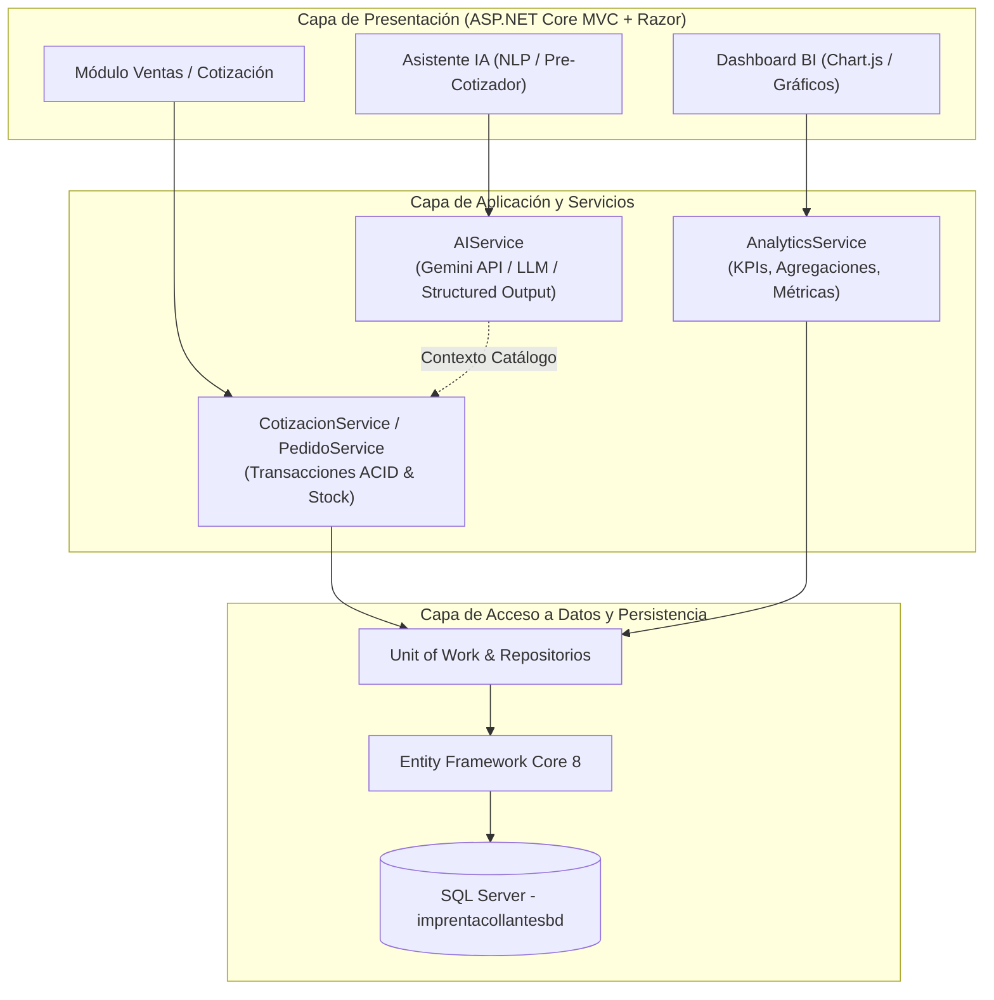

# Especificación de Requerimientos del Sistema (SRS)
## Sistema de Gestión Comercial, Cotizaciones y Producción — Imprenta Collantes

* **Curso:** Diseño y Arquitectura de Software  
* **Nivel:** Ciclo VII — Universidad Privada del Norte (UPN)  
* **Tecnología Base:** ASP.NET Core (.NET 8), Entity Framework Core 8, SQL Server, Bootstrap 5  
* **Pilares de Arquitectura:** Transaccional (OLTP / ACID), Business Intelligence (BI) e Inteligencia Artificial (IA)

---

## 1. Introducción y Alcance

El presente documento formaliza los **Requerimientos Funcionales (RF)** y **Requerimientos No Funcionales (RNF)** para la evolución y completitud del sistema de información comercial y productivo para imprenta. El sistema cubre desde la captación y cotización con asistencia de Inteligencia Artificial, pasando por la conversión transaccional en pedidos de producción con descuento atómico de inventario, hasta la explotación analítica para toma de decisiones gerenciales mediante Business Intelligence.

---

## 2. Diagrama Arquitectónico de los Pilares del Sistema

---

## 3. Requerimientos Funcionales (RF)

### Módulo 1: Seguridad, Autenticación y Auditoría (RBAC)
* **RF-01: Autenticación y Gestión de Sesiones**
  * **Descripción:** El sistema debe permitir el inicio de sesión seguro mediante correo y contraseña cifrada, cierre de sesión y recuperación de contraseña por correo electrónico.
  * **Criterio de Aceptación:** Bloquear accesos tras intentos fallidos y mantener la sesión cifrada mediante cookies provistas por ASP.NET Core Identity.
* **RF-02: Control de Acceso Basado en Roles (RBAC)**
  * **Descripción:** Restricción estricta de controladores y vistas según el rol del usuario autenticado: `Admin` (gestión total, roles y analítica), `Vendedor` (clientes, cotizaciones y pedidos) y `Operador de Taller` (seguimiento de producción).
  * **Criterio de Aceptación:** Todo endpoint sensible debe contar con el atributo `[Authorize(Roles = "...")]`.
* **RF-03: Auditoría y Trazabilidad Automática**
  * **Descripción:** Toda operación de creación o cambio de estado en cotizaciones y pedidos debe vincular automáticamente el identificador del usuario en sesión (`ClaimsPrincipal`), registrando marca de tiempo (timestamp) inmutable.

---

### Módulo 2: Clientes, Proveedores y Catálogo
* **RF-04: Gestión Integral de Clientes**
  * **Descripción:** Registro, edición, búsqueda y consulta de clientes con validación estricta de documentos de identidad peruanos (DNI de 8 dígitos o RUC de 11 dígitos), correo electrónico válido y teléfono.
* **RF-05: Historial y Ficha Comercial del Cliente**
  * **Descripción:** En la vista de detalle del cliente se debe desplegar el histórico completo de sus cotizaciones emitidas, pedidos formalizados y volumen total facturado.
* **RF-06: Gestión de Proveedores e Insumos**
  * **Descripción:** Registro y mantenimiento de proveedores asociados a los insumos y productos de imprenta.
  * **Criterio de Aceptación:** En cualquier desplegable o formulario del sistema se debe mostrar el Nombre/Razón Social del proveedor y no códigos numéricos internos.
* **RF-07: Catálogo de Productos y Servicios de Imprenta**
  * **Descripción:** Mantenimiento de productos terminados y servicios (volantes, gigantografías, encuadernación, tarjetas) con precios base, unidad de medida y stock disponible.

---

### Módulo 3: Flujo Comercial y Transaccional (OLTP - ACID)
* **RF-08: Registro Maestro-Detalle de Cotizaciones**
  * **Descripción:** Registro dinámico de cotizaciones permitiendo asociar un cliente y agregar múltiples líneas de ítems (`DetalleCotizacion`) con producto, tiraje/cantidad y precio unitario pactado.
* **RF-09: Cálculo Automatizado de Importes e Impuestos**
  * **Descripción:** El sistema debe calcular en tiempo real el subtotal por ítem, subtotal general, IGV (18%) y total neto. Queda bloqueada la edición manual del importe total.
* **RF-10: Transacción Atómica de Conversión de Cotización a Pedido**
  * **Descripción:** Al aprobar una cotización, el sistema debe convertirla en un `Pedido` formal ejecutando en una **única transacción atómica (ACID)**:
    1. Creación de la cabecera `Pedido`.
    2. Duplicación de líneas en `DetallePedido`.
    3. Validación y deducción automática del stock en `Producto.Stock`.
    4. Actualización del estado de la cotización a `Aprobada`.
  * **Criterio de Aceptación:** Si un solo producto no cuenta con stock suficiente, la transacción completa debe abortarse (**Rollback**), impidiendo estados inconsistentes en la base de datos.
* **RF-11: Anulación Transaccional de Pedidos**
  * **Descripción:** En caso de cancelación de un pedido en estado inicial, el sistema debe restituir automáticamente el stock a los productos correspondientes dentro de una transacción segura.
* **RF-12: Emisión de Comprobante / Proforma en PDF y Envío por Correo**
  * **Descripción:** Generación de la cotización formal con diseño membretado en formato PDF descargable y opción de envío automático por correo al cliente vía `IEmailSender`.
* **RF-13: Seguimiento del Estado del Pedido (Taller)**
  * **Descripción:** El taller podrá actualizar el flujo del pedido por los estados: `En Cola`, `En Impresión / Acabado`, `Listo para Recojo` y `Entregado`.

---

### Módulo 4: Business Intelligence (BI) y Analítica Gerencial
* **RF-14: Dashboard Ejecutivo Interactivo**
  * **Descripción:** Panel de control principal con tarjetas de indicadores clave (KPIs) actualizados en tiempo real:
    - Total facturado en el mes actual vs. mes anterior.
    - Cantidad de cotizaciones pendientes de respuesta.
    - Pedidos en proceso en taller.
    - Alertas de productos con stock por debajo del umbral mínimo.
* **RF-15: Análisis del Embudo de Conversión Comercial (Funnel)**
  * **Descripción:** Gráfico interactivo que muestre la tasa de conversión comercial: Total de cotizaciones emitidas vs. aprobadas (convertidas a pedido) vs. rechazadas/vencidas.
* **RF-16: Análisis de Tendencia Temporal de Ventas**
  * **Descripción:** Gráfico de líneas temporales (mensual/semanal) con filtros por rango de fechas para evaluar el crecimiento de la facturación.
* **RF-17: Análisis Pareto (80/20) de Productos y Servicios Más Rentables**
  * **Descripción:** Gráfico visual (dona o barras) que identifique el top de productos que generan el 80% de los ingresos de la imprenta.
* **RF-18: Ranking y Segmentación de Clientes (Ticket Promedio)**
  * **Descripción:** Vista analítica que clasifique a los clientes según su volumen de compra acumulado, recurrencia y ticket promedio (clasificación ABC).
* **RF-19: Exportación de Reportes Analíticos**
  * **Descripción:** Los datos del módulo de BI deben ser exportables a formatos Excel (`.xlsx`) y PDF con resúmenes ejecutivos.

---

### Módulo 5: Asistente Inteligente con IA (NLP & Automatización)
* **RF-20: Asistente Inteligente de Pre-Cotización por Lenguaje Natural**
  * **Descripción:** El vendedor podrá ingresar o pegar un texto no estructurado (proveniente de un correo o mensaje de WhatsApp de un cliente) en una caja de texto del módulo de IA.
  * **Criterio de Aceptación:** El servicio de IA procesará el texto y retornará un objeto estructurado (JSON) extrayendo:
    - Datos del cliente (Nombre/Razón Social, DNI/RUC si estuviera presente).
    - Lista de productos identificados con cantidades y descripciones técnicas (tipo de papel, tamaño, acabado).
    - Observaciones o fecha requerida de entrega.
* **RF-21: Autocompletado del Formulario de Cotización desde IA**
  * **Descripción:** Al presionar "Cargar a Cotización", los datos estructurados por la IA deben prellenar automáticamente la pantalla de registro maestro-detalle, asociando los productos coincidentes del catálogo para su revisión final por el vendedor.
* **RF-22: Sugerencia Inteligente de Precios y Descuentos**
  * **Descripción:** La IA evaluará el volumen solicitado (tiraje) y el historial del cliente para sugerir un margen de descuento o precio por volumen recomendado para maximizar la probabilidad de cierre.

---

## 4. Requerimientos No Funcionales (RNF)

| Código | Categoría (ISO 25010) | Requisito y Criterio de Aceptación |
| :--- | :--- | :--- |
| **RNF-01** | **Seguridad** | **Protección contra vulnerabilidades Web:** Toda petición HTTP POST de mutación debe validar tokens anti-falsificación (`[ValidateAntiForgeryToken]`). No deben existir credenciales hardcodeadas en código fuente; las cadenas de conexión y claves de API (Gemini/OpenAI) deben gestionarse mediante variables de entorno o `UserSecrets`. |
| **RNF-02** | **Confiabilidad (ACID)** | **Integridad Transaccional:** Todas las operaciones compuestas (Cotización + Detalles, o Pedido + Deducción de Stock) deben ejecutarse bajo un contexto transaccional (`BeginTransactionAsync`) con nivel de aislamiento `ReadCommitted`. Ante cualquier fallo se ejecutará un Rollback estricto. |
| **RNF-03** | **Concurrencia** | **Manejo de Concurrencia Optimista:** La entidad `Producto` debe implementar un control de concurrencia (`RowVersion` o token de concurrencia) para impedir que dos transacciones simultáneas vendan stock inexistente (*Race Condition*). |
| **RNF-04** | **Arquitectura de Software** | **Desacoplamiento y Principios SOLID:** El sistema debe organizarse en una arquitectura en capas (Presentación, Aplicación/Servicios, Dominio y Persistencia). Los controladores no deben depender directamente de `ApplicationDbContext`, sino de interfaces de servicios (`ICotizacionService`, `IPedidoService`, `IAnalyticsService`, `IAssistantAIService`) respetando el Principio de Inversión de Dependencias (DIP). |
| **RNF-05** | **Rendimiento (BI)** | **Optimización de Consultas Analíticas:** Las consultas del módulo de BI deben ejecutarse en modo solo lectura (`AsNoTracking()`) y aprovechar vistas indexadas o proyecciones directas (`Select`) para garantizar que la carga del Dashboard tome **menos de 1.5 segundos**. |
| **RNF-06** | **Resiliencia y Disponibilidad (IA)** | **Degradación Elegante del Servicio de IA (Fallback):** Si el proveedor de IA externa experimenta caídas, latencia alta (> 5 segundos) o falta de conexión a internet, el sistema no debe bloquearse. Debe emitir una alerta no intrusiva y permitir continuar con el flujo de cotización manual tradicional. |
| **RNF-07** | **Mantenibilidad** | **Consolidación del Modelo ORM:** El sistema operará bajo un único `ApplicationDbContext` limpio y normalizado en EF Core 8, eliminando scripts huérfanos (`DbContextNombre`) y unificando las identidades con `IdentityUser`. |
| **RNF-08** | **Usabilidad e Interfaz** | **Diseño Responsivo y Visualización de Datos:** La interfaz web debe ser 100% responsiva (Bootstrap 5). Las gráficas del módulo de BI deben renderizarse mediante librerías modernas del lado del cliente (`Chart.js` o `ApexCharts`) con adaptación a dispositivos móviles. |
| **RNF-09** | **Tolerancia a Fallos y Logging** | **Manejo Centralizado de Excepciones:** En entorno de producción queda prohibido exponer páginas con trazas de error (stack traces) al usuario. Los errores no controlados deben capturarse en un middleware global, registrarse mediante `ILogger` y mostrar una vista amigable (`/Home/Error`). |

---

## 5. Matriz de Cobertura y Trazabilidad Arquitectónica

| Pilar Evaluado | Módulos Asociados | Requerimientos Clave |
| :--- | :--- | :--- |
| **Transaccional (ACID & Stock)** | Cotizaciones, Pedidos, Almacén | RF-08, RF-09, RF-10, RF-11, RNF-02, RNF-03 |
| **Business Intelligence (BI)** | Dashboard Ejecutivo, Analítica Comercial | RF-14, RF-15, RF-16, RF-17, RF-18, RF-19, RNF-05 |
| **Inteligencia Artificial (IA)** | Asistente NLP, Sugerencias de Precios | RF-20, RF-21, RF-22, RNF-06 |
| **Arquitectura Base & Seguridad** | RBAC, Capas, Servicios, Inversión de Dependencias | RF-01, RF-02, RF-03, RNF-01, RNF-04, RNF-07 |
