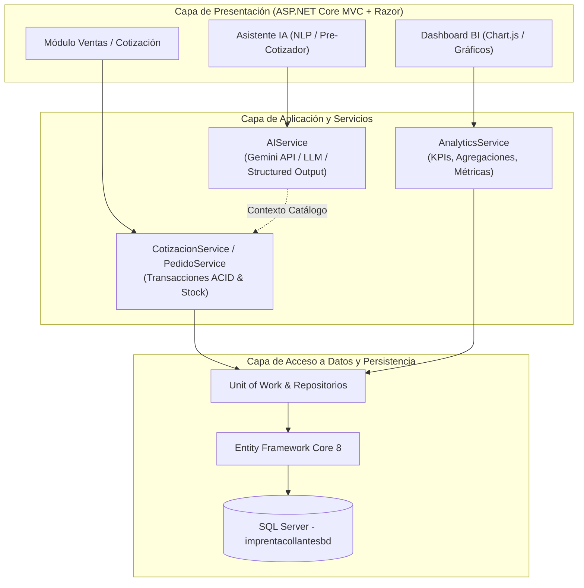

# Especificación de Requerimientos del Sistema (SRS)
## Sistema de Gestión Comercial, Cotizaciones y Producción — Imprenta Collantes

* **Curso:** Diseño y Arquitectura de Software  
* **Nivel:** Ciclo VII — Universidad Privada del Norte (UPN)  
* **Tecnología Base:** ASP.NET Core (.NET 8), Entity Framework Core 8, SQL Server, Bootstrap 5  
* **Pilares de Arquitectura:** Transaccional (OLTP / ACID), Business Intelligence (BI) e Inteligencia Artificial (IA)

---

## 1. Introducción y Alcance

El presente documento formaliza los **Requerimientos Funcionales (RF)** y **Requerimientos No Funcionales (RNF)** para la evolución y completitud del sistema de información comercial y productivo para imprenta. El sistema cubre desde la captación y cotización con asistencia de Inteligencia Artificial, pasando por la conversión transaccional en pedidos de producción con descuento atómico de inventario, hasta la explotación analítica para toma de decisiones gerenciales mediante Business Intelligence.

---

## 2. Diagrama Arquitectónico de los Pilares del Sistema

---

## 3. Requerimientos Funcionales (RF)

### Módulo 1: Seguridad, Autenticación y Auditoría (RBAC)
* **RF-01: Autenticación y Gestión de Sesiones**
  * **Descripción:** El sistema debe permitir el inicio de sesión seguro mediante correo y contraseña cifrada, cierre de sesión y recuperación de contraseña por correo electrónico.
  * **Criterio de Aceptación:** Bloquear accesos tras intentos fallidos y mantener la sesión cifrada mediante cookies provistas por ASP.NET Core Identity.
* **RF-02: Control de Acceso Basado en Roles (RBAC)**
  * **Descripción:** Restricción estricta de controladores y vistas según el rol del usuario autenticado: `Admin` (gestión total y asignación de roles/permisos), `Vendedor` (clientes, cotizaciones y ventas) y `Operador de Taller` (seguimiento de producción). La matriz de acceso relaciona roles con menús y operaciones (`ver`, `crear`, `editar`, `eliminar`, `procesar`).
  * **Criterio de Aceptación:** Los endpoints sensibles deben requerir autenticación y validar en el servidor el permiso por rol y operación; ocultar el menú no constituye autorización. `Admin` tiene acceso total y puede administrar los permisos de los demás roles.
* **RF-03: Auditoría y Trazabilidad Automática**
  * **Descripción:** Las creaciones y cambios de estado de cotizaciones, ventas y pedidos registran identificador del usuario en sesión (`ClaimsPrincipal`), fecha/hora UTC y transición; los vencimientos automáticos quedan identificados como acciones del sistema. El historial solo es visible para `Admin`.

---

### Módulo 2: Clientes, Proveedores y Catálogo
* **RF-04: Gestión Integral de Clientes**
  * **Descripción:** Registro, edición, búsqueda y consulta de clientes con validación estricta de documentos de identidad peruanos (DNI de 8 dígitos o RUC de 11 dígitos), correo electrónico válido y teléfono.
  * **Estado actual:** selector de tipo de documento importado de `facturuna`, número de documento y nombre/razón social; dirección y ubigeo de distrito obligatorios con RUC y opcionales con DNI. Los DNI antiguos se conservan. Se valida el formato y unicidad en clientes, no la situación tributaria ante SUNAT; búsqueda avanzada sigue pendiente.
* **RF-05: Historial y Ficha Comercial del Cliente**
  * **Descripción:** En la vista de detalle del cliente se debe desplegar el histórico completo de sus cotizaciones emitidas, pedidos formalizados y volumen total facturado.
* **RF-06: Gestión de Proveedores e Insumos**
  * **Descripción:** Registro y mantenimiento de proveedores asociados a los insumos y productos de imprenta.
  * **Criterio de Aceptación:** En cualquier desplegable o formulario del sistema se debe mostrar el Nombre/Razón Social del proveedor y no códigos numéricos internos.
  * **Estado actual:** nuevos registros y ediciones requieren RUC, dirección y distrito del ubigeo; los proveedores anteriores mantienen campos desconocidos vacíos hasta su actualización. El catálogo `ubigeo` proviene de MySQL y se consulta localmente en SQL Server.
* **RF-07: Catálogo de Productos y Servicios de Imprenta**
  * **Descripción:** Mantenimiento de artículos y servicios de imprenta, con precios base; solo los artículos participan en el control de stock. Los registros anteriores a la clasificación deben revisarse manualmente para marcar los servicios reales. La unidad de medida continúa como capacidad objetivo.
  * **Estado actual:** se importaron 64 unidades de medida desde `bmotors` y se creó el esquema para presentaciones por producto con factor en unidad base. Todavía no se asignaron unidades base ni presentaciones a los productos existentes. También se prepararon las tablas `Almacen`, `Stock`, `CorteInventario` y `Kardex`, vacías y sin procesos; las ventas y alertas siguen usando `Producto.Stock` hasta el traspaso operativo conjunto. No hay módulo de inventario funcional ni stock inicial registrado en las tablas nuevas.

---

### Módulo 3: Flujo Comercial y Transaccional (OLTP - ACID)
* **RF-08: Registro Maestro-Detalle de Cotizaciones**
  * **Descripción:** Registro dinámico de cotizaciones permitiendo asociar un cliente y agregar múltiples líneas de ítems (`DetalleCotizacion`) con producto, tiraje/cantidad y precio unitario pactado.
* **RF-09: Cálculo Automatizado de Importes e Impuestos**
  * **Descripción:** El sistema debe calcular en tiempo real el subtotal por ítem, subtotal general, IGV (18%) y total neto. Queda bloqueada la edición manual del importe total.
* **RF-10: Transacción Atómica de Conversión de Cotización a Venta y Pedido de Taller**
  * **Descripción:** Al pulsar «Confirmar venta» en una cotización `Emitida` y vigente, el sistema ejecuta en una **única transacción atómica (ACID)**:
    1. Reserva la conversión única de la cotización y valida el stock de artículos; se permite cotizar sin existencias, pero no confirmar una venta sin ellas.
    2. Crea la `Venta` comercial y sus líneas (`DetalleVenta`) con los importes pactados, y descuenta stock de artículos (no de servicios).
    3. Crea un `Pedido` de taller asociado a la venta, copia sus líneas (`DetallePedido`) y lo deja `En cola`.
    4. Marca la cotización `Convertida` y bloquea su edición.
  * **Criterio de Aceptación:** Una cotización genera como máximo una venta y un trabajo asociado. Si algún artículo no tiene stock suficiente, no se crea ninguno de ellos ni se descuenta inventario (**Rollback**).
* **RF-11: Anulación Transaccional de Ventas**
  * **Descripción:** Solo se puede cancelar la venta y su pedido asociado mientras el trabajo siga `En cola`. La operación restituye stock de artículos (no servicios) de forma transaccional; una vez iniciado el trabajo no se puede cancelar por este flujo.
* **RF-12: Emisión de Comprobante / Proforma en PDF y Envío por Correo**
  * **Descripción:** Generación de la cotización formal con diseño membretado en formato PDF descargable y opción de envío automático por correo al cliente vía `IEmailSender`.
* **RF-13: Seguimiento del Estado del Pedido (Taller)**
  * **Descripción:** El taller puede avanzar el pedido solo al siguiente estado: `En cola` → `En impresión / acabado` → `Listo para recojo` → `Entregado`. `Cancelado` solo es posible al cancelar la venta antes de iniciar el trabajo.

---

### Módulo 4: Business Intelligence (BI) y Analítica Gerencial
* **Estado actual:** `Analytics/Index` ofrece un primer panel solo para `Admin`, respaldado por ventas confirmadas y sus costos unitarios históricos (opcionales). La migración `AddHistoricalCosts` ya fue aplicada en la base local tras respaldo verificado. Exportación y comparaciones entre periodos no están implementadas; las descripciones restantes representan el alcance objetivo.
* **RF-14: Dashboard Ejecutivo Interactivo**
  * **Descripción:** Panel de indicadores clave (KPIs) basados en datos reales:
    - Ventas confirmadas agrupadas por fecha de confirmación en hora peruana, con IGV mostrado y desglosado; no se llaman «facturadas» mientras no exista facturación real.
    - Cotizaciones emitidas en el periodo, convertidas, vigentes y vencidas según fecha de emisión.
    - Pedidos en proceso en taller.
    - Alertas de artículos con stock menor o igual al umbral seleccionado.
    - Utilidad estimada sin IGV de líneas con costo registrado; indicar explícitamente cuando la cobertura es parcial.
* **RF-15: Análisis del Embudo de Conversión Comercial (Funnel)**
  * **Descripción:** Tasa de conversión comercial: cotizaciones convertidas / cotizaciones emitidas en el periodo. La visualización como embudo interactivo es posterior.
* **RF-16: Análisis de Tendencia Temporal de Ventas**
  * **Descripción:** Serie mensual/semanal de ventas confirmadas con IGV y filtros por rango de fechas. El panel actual utiliza barras accesibles en lugar de depender de una librería de gráficos.
* **RF-17: Análisis Pareto (80/20) de Productos y Servicios Más Vendidos**
  * **Descripción:** Ranking por ingresos con IGV y porcentaje acumulado; no llamar «rentables» a productos sin un cálculo completo de costos e impuestos.
* **RF-18: Ranking y Segmentación de Clientes (Ticket Promedio)**
  * **Descripción:** Ranking por ventas confirmadas con IGV en el periodo, cantidad, ticket medio y grupo ABC por proporción acumulada de ingresos. Un análisis histórico de recurrencia queda pendiente.
* **RF-19: Exportación de Reportes Analíticos**
  * **Descripción:** Los datos del módulo de BI deben ser exportables a formatos Excel (`.xlsx`) y PDF con resúmenes ejecutivos.

---

### Módulo 5: Asistente Inteligente con IA (NLP & Automatización)
* **Estado actual:** pre-cotización optativa con Groq; revisión explícita de texto anonimizado antes de la llamada, permisos de creación de cotizaciones, validación de respuesta y traspaso a formulario normal sin guardado automático. Sin clave o ante fallos se sigue cotizando manualmente. El formulario asistido muestra referencias monetarias **calculadas localmente**, nunca por la IA, con margen bruto mínimo del 10 % sobre precio sin IGV cuando el costo está registrado. No existen descuentos automáticos ni optimización predictiva de cierres.
* **RF-20: Asistente Inteligente de Pre-Cotización por Lenguaje Natural**
  * **Descripción:** El vendedor podrá ingresar o pegar un texto no estructurado (proveniente de un correo o mensaje de WhatsApp de un cliente) en una caja de texto del módulo de IA.
  * **Criterio de Aceptación:** El servicio de IA procesará el texto y retornará un objeto estructurado (JSON) extrayendo:
    - Datos del cliente (Nombre/Razón Social, DNI/RUC si estuviera presente).
    - Lista de productos identificados con cantidades y descripciones técnicas (tipo de papel, tamaño, acabado).
    - Observaciones o fecha requerida de entrega.
* **RF-21: Autocompletado del Formulario de Cotización desde IA**
  * **Descripción:** Al presionar "Cargar a Cotización", los datos estructurados por la IA deben prellenar automáticamente la pantalla de registro maestro-detalle, asociando los productos coincidentes del catálogo para su revisión final por el vendedor.
* **RF-22: Sugerencia Inteligente de Precios y Descuentos**
  * **Descripción:** La IA evaluará el volumen solicitado (tiraje) y el historial del cliente para sugerir un margen de descuento o precio por volumen recomendado para maximizar la probabilidad de cierre.
  * **Estado parcial implementado:** se acordó un margen bruto mínimo del 10 % (`precio mínimo sin IGV = techo_a_céntimos(costo sin IGV / 0,90)`). Si el costo actual es conocido y mayor que cero, se calcula el descuento máximo frente al catálogo; el formulario muestra la última venta confirmada del cliente/producto y permite evaluar repetirla solo si no baja del mínimo, no supera el catálogo y el nuevo tiraje no es menor. Se validan mínimos al guardar y confirmar ventas. Sin costo no se estima descuento; la referencia histórica puede no ser comparable por especificaciones. La IA no decide descuentos ni precios aplicados; sigue pendiente el modelo predictivo de cierre planteado en la descripción objetivo.

---

## 4. Requerimientos No Funcionales (RNF)

| Código | Categoría (ISO 25010) | Requisito y Criterio de Aceptación |
| :--- | :--- | :--- |
| **RNF-01** | **Seguridad** | **Protección contra vulnerabilidades Web:** Toda petición HTTP POST de mutación debe validar tokens anti-falsificación (`[ValidateAntiForgeryToken]`). No deben existir credenciales hardcodeadas en código fuente; las cadenas de conexión y claves de API (Gemini/OpenAI) deben gestionarse mediante variables de entorno o `UserSecrets`. |
| **RNF-02** | **Confiabilidad (ACID)** | **Integridad Transaccional:** Las operaciones compuestas (Cotización + Detalles; confirmación de Venta + Pedido + stock; cancelación + restitución de stock) se ejecutan en una transacción (`BeginTransactionAsync`) con aislamiento `ReadCommitted`. Ante un fallo se revierte la transacción completa. |
| **RNF-03** | **Concurrencia** | **Manejo de Concurrencia:** `Producto.RowVersion` impide sobrescribir ediciones de stock desactualizadas. La confirmación usa actualización condicional de inventario y reserva exclusiva de cotización; la cancelación y el inicio del taller usan transiciones condicionales dentro de transacciones para que no puedan ganar ambos a la vez. |
| **RNF-04** | **Arquitectura de Software** | **Desacoplamiento y Principios SOLID:** El sistema debe organizarse en una arquitectura en capas (Presentación, Aplicación/Servicios, Dominio y Persistencia). Los controladores no deben depender directamente de `ApplicationDbContext`, sino de interfaces de servicios (`ICotizacionService`, `IPedidoService`, `IAnalyticsService`, `IAssistantAIService`) respetando el Principio de Inversión de Dependencias (DIP). |
| **RNF-05** | **Rendimiento (BI)** | **Optimización de Consultas Analíticas:** Las consultas del módulo de BI deben ejecutarse en modo solo lectura (`AsNoTracking()`) y aprovechar vistas indexadas o proyecciones directas (`Select`) para garantizar que la carga del Dashboard tome **menos de 1.5 segundos**. |
| **RNF-06** | **Resiliencia y Disponibilidad (IA)** | **Degradación Elegante del Servicio de IA (Fallback):** Si el proveedor de IA externa experimenta caídas, latencia alta (> 5 segundos) o falta de conexión a internet, el sistema no debe bloquearse. Debe emitir una alerta no intrusiva y permitir continuar con el flujo de cotización manual tradicional. |
| **RNF-07** | **Mantenibilidad** | **Consolidación del Modelo ORM:** El sistema operará bajo un único `ApplicationDbContext` limpio y normalizado en EF Core 8, eliminando scripts huérfanos (`DbContextNombre`) y unificando las identidades con `IdentityUser`. |
| **RNF-08** | **Usabilidad e Interfaz** | **Diseño Responsivo y Visualización de Datos:** La interfaz web debe ser 100% responsiva (Bootstrap 5). Las gráficas del módulo de BI deben renderizarse mediante librerías modernas del lado del cliente (`Chart.js` o `ApexCharts`) con adaptación a dispositivos móviles. |
| **RNF-09** | **Tolerancia a Fallos y Logging** | **Manejo Centralizado de Excepciones:** En entorno de producción queda prohibido exponer páginas con trazas de error (stack traces) al usuario. Los errores no controlados deben capturarse en un middleware global, registrarse mediante `ILogger` y mostrar una vista amigable (`/Home/Error`). |

---

## 5. Matriz de Cobertura y Trazabilidad Arquitectónica

| Pilar Evaluado | Módulos Asociados | Requerimientos Clave |
| :--- | :--- | :--- |
| **Transaccional (ACID & Stock)** | Cotizaciones, Ventas, Pedidos, Almacén | RF-08, RF-09, RF-10, RF-11, RNF-02, RNF-03 |
| **Business Intelligence (BI)** | Dashboard Ejecutivo, Analítica Comercial | RF-14, RF-15, RF-16, RF-17, RF-18, RF-19, RNF-05 |
| **Inteligencia Artificial (IA)** | Asistente NLP, Sugerencias de Precios | RF-20, RF-21, RF-22, RNF-06 |
| **Arquitectura Base & Seguridad** | RBAC, Capas, Servicios, Inversión de Dependencias | RF-01, RF-02, RF-03, RNF-01, RNF-04, RNF-07 |
