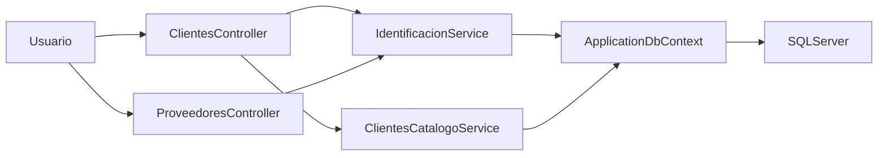
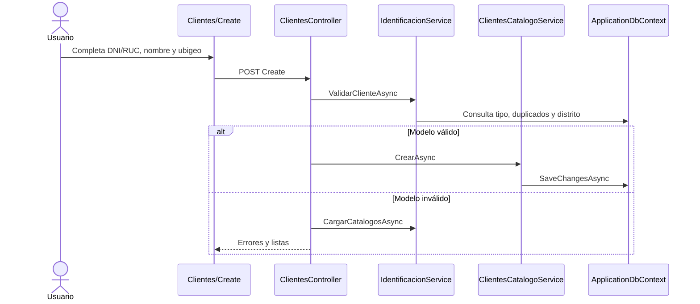

# Respuesta al prompt del Entregable 1 — reconocimiento y propuesta

> Estado: diagnóstico preliminar de FASE 0 y revisión del alcance. No representa el informe final de E1 ni afirma que existan ramas, PR, etiquetas o entregables no verificados. Fecha de revisión: 2026-11-14.

## Datos del equipo pendientes

- Integrantes y usuarios GitHub: **no proporcionados**.
- URL de GitHub: **no verificada**; `git remote -v` no devolvió remotos.
- Módulo propuesto: **identificación y registro de clientes/proveedores**.
- Herramienta de IA: OpenCode (GPT-6 Sol); revisión y responsabilidad de los estudiantes pendientes.

## FASE 0 — Reconocimiento verificable

**Sistema:** Imprenta Collantes, aplicación interna de gestión comercial y taller. El usuario administrador puede gestionar clientes, proveedores, productos, cotizaciones, ventas y seguimiento de pedidos. Los registros públicos no obtienen automáticamente acceso a CRUD (ver `ProyectoFinal/Controllers/ClientesController.cs:13-24`, `ProyectoFinal/Controllers/PreCotizacionController.cs:11-15` y `AGENTS.md`).

**Tecnología:** C# / ASP.NET Core 8 MVC e Identity Razor Pages; EF Core 8 y SQL Server (`ProyectoFinal/ProyectoFinal.csproj:1-19`, `ProyectoFinal/Data/ApplicationDbContext.cs:7-12`); xUnit, EF InMemory y Microsoft.AspNetCore.Mvc.Testing (`ProyectoFinal.Tests/ProyectoFinal.Tests.csproj:8-16`). Desde la raíz: `dotnet build ProyectoFinal.sln`, `dotnet test ProyectoFinal.sln`, `dotnet run --project ProyectoFinal/ProyectoFinal.csproj --launch-profile http`. No se constató IDE usado por el equipo.

| Módulo | Responsabilidad | Depende de | Evidencia |
|---|---|---|---|
| Clientes / proveedores | Formularios y acciones CRUD | Servicios de catálogo e identificación | `ProyectoFinal/Controllers/ClientesController.cs:14-25,57-78`; `ProyectoFinal/Controllers/ProveedorsController.cs` |
| Identificación | Validar documento, ubigeo, cargar catálogos | EF Core / ApplicationDbContext | `ProyectoFinal/Services/IdentificacionService.cs:8-16,17-43,46-117` |
| Persistencia | Entidades, relaciones y migraciones | SQL Server / EF Core | `ProyectoFinal/Data/ApplicationDbContext.cs:7-54,126-130` |
| Presentación | Vista de cliente y selector de ubicación | MVC / ViewBag | `ProyectoFinal/Views/Shared/_ClienteFormFields.cshtml:1-35`; `ProyectoFinal/Views/Shared/_UbigeoFields.cshtml:1-34` |
| Pruebas | Validar flujos HTTP y reglas | xUnit / EF InMemory | `ProyectoFinal.Tests/NavigationTests.cs:1068-1180` |

Reglas observadas: DNI de ocho dígitos y RUC de once; con RUC, dirección y distrito son obligatorios; duplicados por tipo/documento rechazados (`IdentificacionService.cs:28-43`). Un distrito debe existir y tener provincia/departamento (`IdentificacionService.cs:83-94`). El selector de departamentos depende de `IdParent == 0` (`IdentificacionService.cs:96-113`). **Análisis dinámico limitado:** se compilaron la solución y pruebas focalizadas de Groq durante esta sesión; no se documentó una ejecución completa de los flujos de registro como evidencia E1.

## FASE 1 — Diagnóstico inicial de mantenibilidad

| ID | Problema y evidencia | Principio / impacto | Mejora y entregable |
|---|---|---|---|
| P1 | `IdentificacionService.ValidarClienteAsync` (líneas 17-43) y `ValidarProveedorAsync` (46-80) normalizan entradas, consultan EF, evalúan negocio y escriben ModelState. | SRP: reglas y acceso a datos ligados a MVC; pruebas unitarias aisladas más difíciles. | E1: extraer primero reglas puras (formato y normalización de documento) detrás de métodos/clase comprobables, sin cambiar mensajes ni resultados. |
| P2 | Validación de documentos y duplicados en `IdentificacionService.cs:28-38,63-75`; las longitudes dependen del código en ambos métodos. | DRY: una futura variante exige mantener dos rutas coherentes. | E2: concentrar especificaciones de documentos en una sola política, después de caracterización. |
| P3 | `IdentificacionService.cs:70-72` usa `switch` por código, y `ValidarClienteAsync` contiene la alternativa DNI/RUC (`:33-35`). | OCP: añadir tipos exige modificar reglas existentes. | E2: estrategias configuradas/injectadas por tipo, sin alterar contratos existentes. |
| P4 | `CargarCatalogosAsync` (`IdentificacionService.cs:96-117`) usa `ViewBag` y `Controller` como dependencia del servicio. | Acoplamiento de presentación: impide reutilización simple fuera de MVC. | E2: retorno tipado de catálogos y adaptación en controlador. |

**Nota de prioridad:** el prompt se contradice: FASE 1 pide SRP **y DRY** en E1, pero FASE 3 asigna CR-02 (DRY) a E2. Propuesta coherente: CR-01 SRP en E1, CR-02 DRY en E2, como exige la lista de CR y la preparación de E2. Confirmar con docente/equipo antes de registrar alcance definitivo.

## Gestión de configuración: lo verificado y lo pendiente

- Ya existe Git; rama actual `master`, sin remoto registrado. **No** se debe afirmar que `main`, `develop`, `v1.0.0`, PR, issues o release existan. El árbol de trabajo tiene cambios previos sin confirmar; no etiquetar el estado actual como «código original».
- `.gitignore` ignora `.vs/`, `**/bin/`, `**/obj/` y backups (`.gitignore:1-12`), pero conviene agregar `.env` y revisar el resto con el equipo antes de publicar.
- `README.md` ya contiene requisitos, arranque, migraciones y advertencias sobre datos reales: actualizarlo, no reemplazarlo indiscriminadamente.
- La base existente tiene esquema y migraciones propios; respaldar y conciliar antes de aplicar nuevas migraciones (`README.md:15-27`, `AGENTS.md`). No incluir claves de Groq ni secretos de SMTP en artefactos académicos.
- Pendientes sujetos a aprobación de equipo: `docs/arquitectura.md`, `docs/diagnostico.md`, `CONTRIBUTING.md`, `CHANGELOG.md`, plantillas, CI, inventario CI, CR-01..04, registro IA y `docs/entregables/REPORTE_E1.md`. No se crearon ni se reportan como entregados en este archivo.

## Propuesta de avance E1 (antes de cada cambio, solicitar confirmación)

1. Completar datos del equipo y elegir un commit **real** como línea base; evitar firmar o etiquetar trabajo ajeno.
2. Escribir 5–10 pruebas de caracterización para DNI/RUC, duplicado, ubigeo requerido y opcional, cliente/proveedor y fallo; comprobar que pasan antes de refactorizar con `dotnet test ProyectoFinal.sln`.
3. Registrar CR-01 y extraer la parte puramente validable de `IdentificacionService` en cambios pequeños; volver a ejecutar las mismas pruebas tras cada paso. Registrar resultados, no inventarlos.
4. Preparar CR-02 (DRY), CR-03 (OCP/IoC) y CR-04 (mejora funcional a acordar) **sin implementarlos en E1**. Asignar responsables cuando el equipo los proporcione.
5. Preparar los archivos, issues y reporte que enumera el prompt, con enlaces reales solo cuando existan. Crear tags y releases únicamente tras revisión y autorización del equipo.

**Respecto a la petición independiente de Groq:** la integración de una clave editable por Admin es una mejora funcional, no un refactor sin cambio observable; no debe presentarse como CR-01 ni etiquetarse automáticamente como v1.0.1 del entregable académico.
