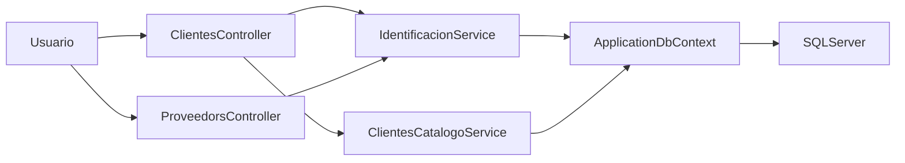
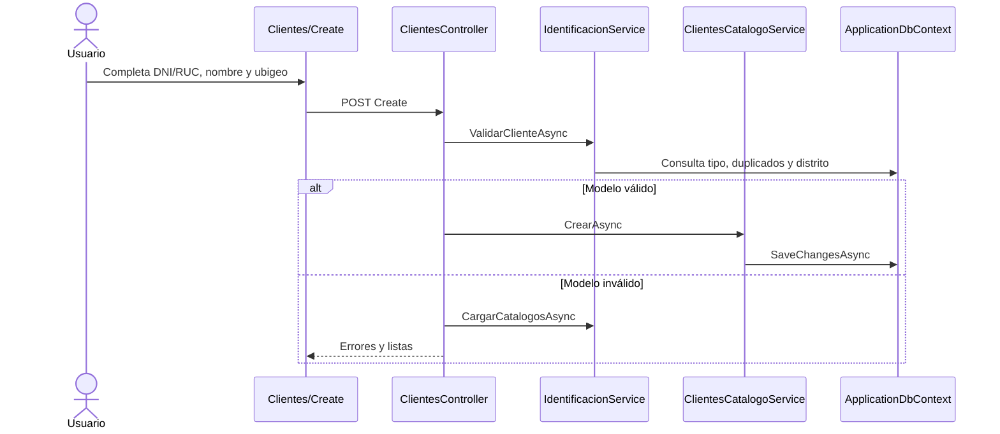

# Arquitectura del módulo de identificación

El sistema Imprenta Collantes usa ASP.NET Core 8 MVC, EF Core 8 y SQL Server. El registro de clientes/proveedores pasa por controladores y `IdentificacionService`, que consulta los tipos de documento y el ubigeo en `ApplicationDbContext` (`ClientesController.cs:57-78`; `IdentificacionService.cs:17-43,46-117`).

